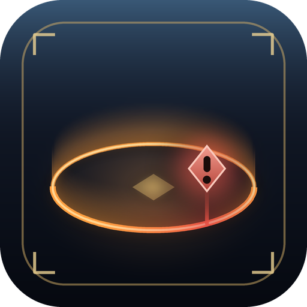

<p align="center">
  
</p>

# FateLimit

**See the edge of every FATE, and know before you step out of it.**

A [Dalamud](https://github.com/goatcorp/Dalamud) plugin for Final Fantasy XIV that draws the border of FATE areas right in the world. Wander too close to the edge and the border turns to a warning colour, a banner tells you how far you have left and a marker hovers over the nearest point — so you stop losing your level sync by chasing a mob one step too far.

[](https://www.patreon.com/GitHixy)
[](https://discord.gg/9kjUjWDBkJ)

[](LICENSE)


---

## What it does

### Five border styles

Each style is made to sit in Eorzea rather than on top of it, and each keeps its own colour and settings, so you can switch back and forth without losing anything.

| Style | The idea |
| --- | --- |
| **Aether ring** | A softly glowing ring with a faint inner line, like a magic circle, and a shimmer running along it. *(default)* |
| **Barrier wall** | A translucent wall rising from the ground, like the barriers around a raid arena, with light streaks and a sweep running up it. |
| **Marching dashes** | Dashes marching around the edge, like the outline of a ground marker. |
| **Crystal runes** | Floating crystal diamonds on pillars of light, slowly turning, linked by a thin thread. |
| **FATE ember** | A warm band fading inward from the edge, like the FATE circle on your map, gently flickering. |

Every style can be tuned: colour, thickness, height (wall, pillars or band), spacing (dashes, runes or streaks), glow, and animation speed — with a live preview in the settings window.

### Always, or only when it matters

- **Always** — every running FATE around you is outlined, up to a draw distance you choose. Or just the one you're standing in.
- **Only near the edge** — nothing on screen until you get within the warning distance of the edge of the FATE you're in. Then the border fades in.

Either way you can:

- warn only about the FATE you're **level-synced** to, which is the one that costs you something to leave;
- also see a FATE's edge as you walk up to it **from outside**;
- **fade the far parts of the ring**, so a huge FATE doesn't draw a circle across the whole screen;
- include FATEs that are still **waiting for someone to start them**.

### The warning

As you near the edge:

- the part of the border close to you **blends into the warning colour**;
- a **banner** at the top of the screen shows the distance left to the border — and, if you do step out, how far back it is;
- a **warning gem** hovers over the closest point of the border, with a ring pulsing on the ground beneath it.

### Follows the ground

Borders are laid over the terrain, so they climb hills and dip into hollows instead of sinking into slopes or floating in the air. Small props like fences and crates are smoothed over.

## Getting started

| Command | What it does |
| --- | --- |
| `/fatelimit` or `/fl` | Open the settings |
| `/fatelimit test` | Place or remove a practice FATE around you |
| `/fatelimit toggle` | Turn borders on or off |

The practice FATE is the quickest way to try things: place it, open **Settings → Style**, and walk towards its edge.

## Plays by the rules

FateLimit is purely visual. It reads where FATEs are — which the game already shows on your map — and draws over the screen. It never moves your character, never sends anything to the game and hides itself in cutscenes, GPose and when the game UI is hidden. Settings live in your Dalamud configuration folder and nothing is ever uploaded.

## Found a bug? Have an idea?

Open **Settings → Diagnostics**. It shows the FATEs around you and how FateLimit sees them, keeps a live log, and has buttons to copy a report and open a GitHub issue for a bug or a feature request. For quick questions, come and talk on [Discord](https://discord.gg/9kjUjWDBkJ).

## Building

Requires the .NET SDK and a Dalamud dev environment (XIVLauncher with Dalamud installed).

```
dotnet build -c Release
```

The built plugin lands in `bin/Release/`. To run it as a dev plugin, copy `FateLimit.dll`, `FateLimit.deps.json` and `FateLimit.json` into `%AppData%\XIVLauncher\devPlugins\FateLimit\`, then reload it from `/xlplugins` → Dev Tools.

The icon is generated by `python tools/make_icon.py` (needs Pillow and NumPy).

## Also by GitHixy

- [LootView](https://github.com/GitHixy/LootView) — a live loot tracker with history and statistics.
- [HitSpark](https://github.com/GitHixy/HitSpark) — animated, styleable combat text.

## License

GPL-3.0. See [LICENSE](LICENSE).
